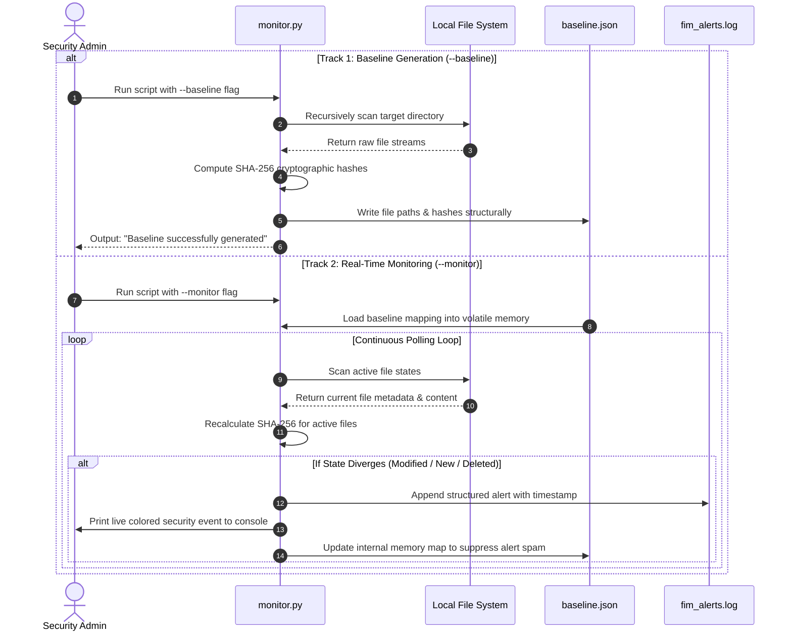

# File Integrity Monitor

A small Python command-line tool that tracks file contents with SHA-256 hashes
and reports files that are added, changed, or removed.

## Requirements

- Python 3.8 or newer

The monitor uses only the Python standard library.

## Usage

Generate a baseline for a directory:

```sh
python monitor.py secure_folder --baseline
```

Start continuous monitoring against that baseline:

```sh
python monitor.py secure_folder --monitor
```

Run both commands from the same working directory. The baseline (`baseline.json`)
and alert log (`fim_alerts.log`) are stored in the current working directory.
Press Ctrl+C to stop monitoring. The default scan interval is two seconds.

To see all command-line options:

```sh
python monitor.py --help
```

## Tests

Run the tests with the standard-library test runner:

```sh
python -m unittest discover -s tests -v
```

The tests use temporary directories and do not modify the sample files in
`secure_folder`.

## Python API documentation

The functions in `monitor.py` have pydoc-compatible docstrings. View them in
the terminal with:

```sh
python -m pydoc monitor
```

Public functions:

- `calculate_sha256(file_path)` computes the SHA-256 digest of one file.
- `generate_baseline(target_directory)` recursively hashes a directory and
  writes `baseline.json`.
- `monitor_directory(target_directory, interval=2)` compares each scan with
  the loaded baseline and reports changes.
- `log_event(status, file_path, message="")` prints and appends an alert.

## 🏗️ System Architecture

The following diagram illustrates how the File Integrity Monitor (FIM) operates across its two distinct operational execution tracks:


